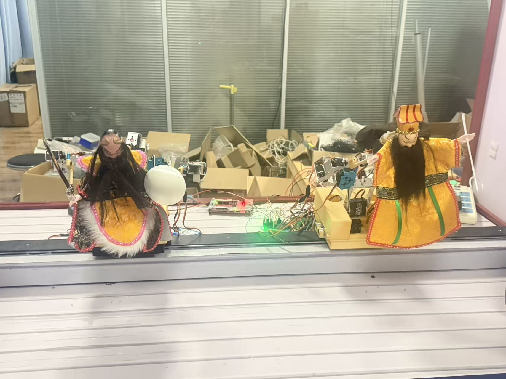
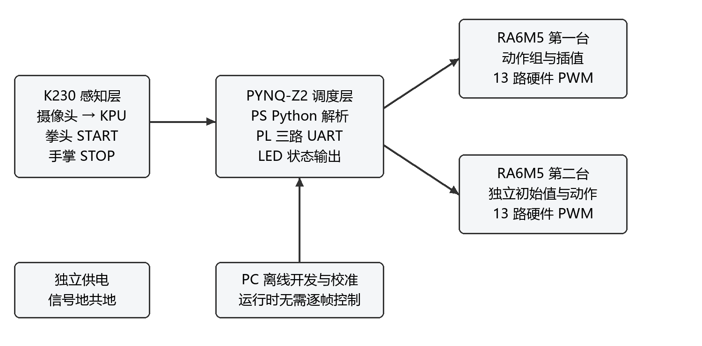
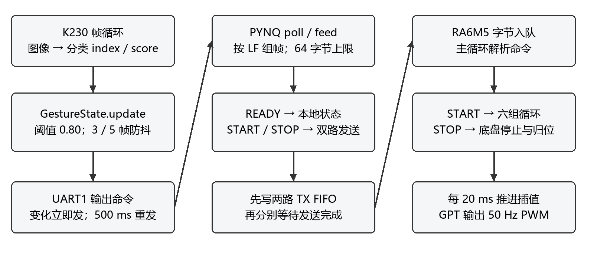
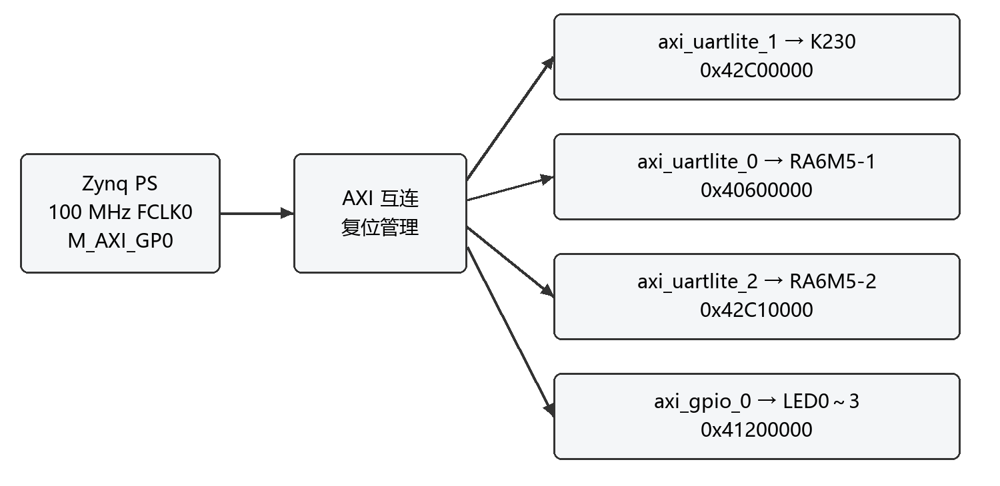
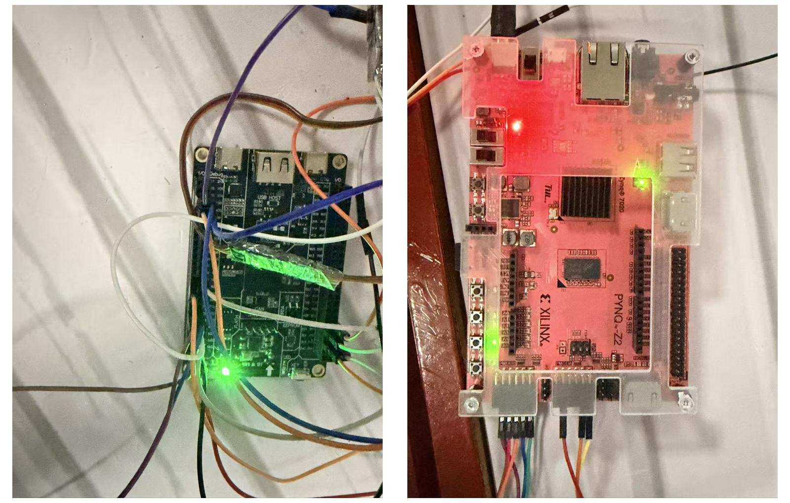
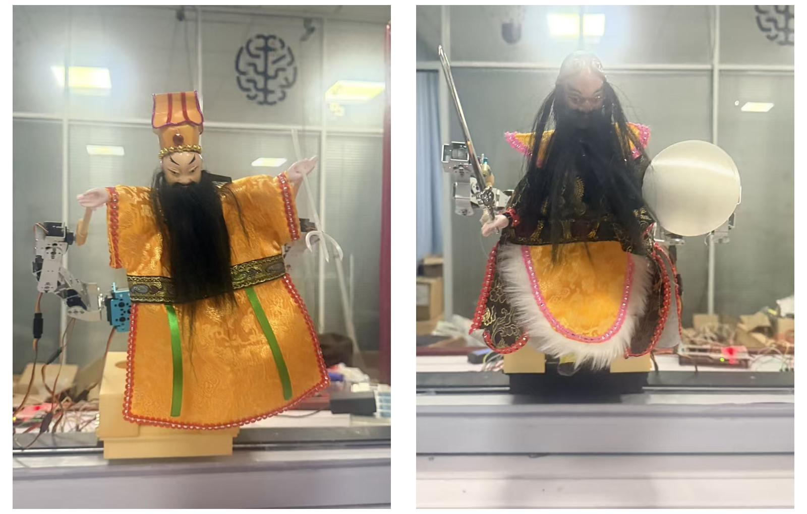
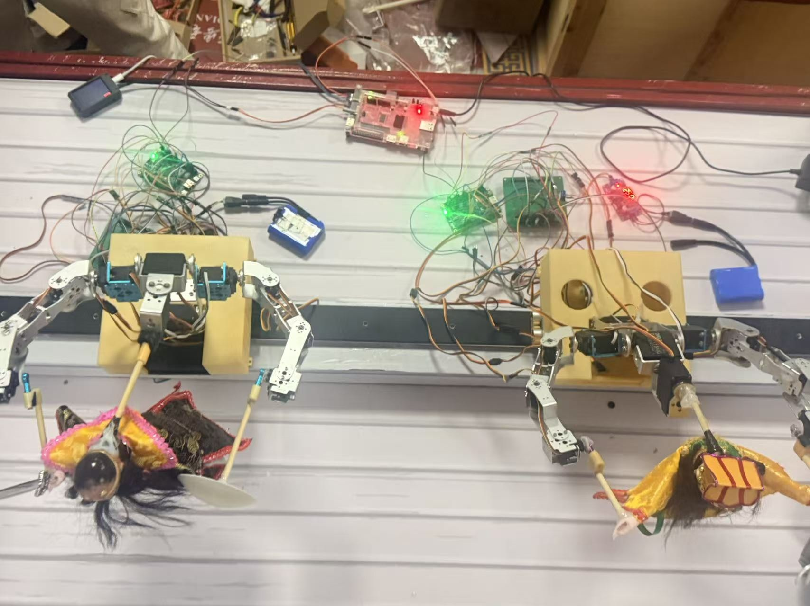
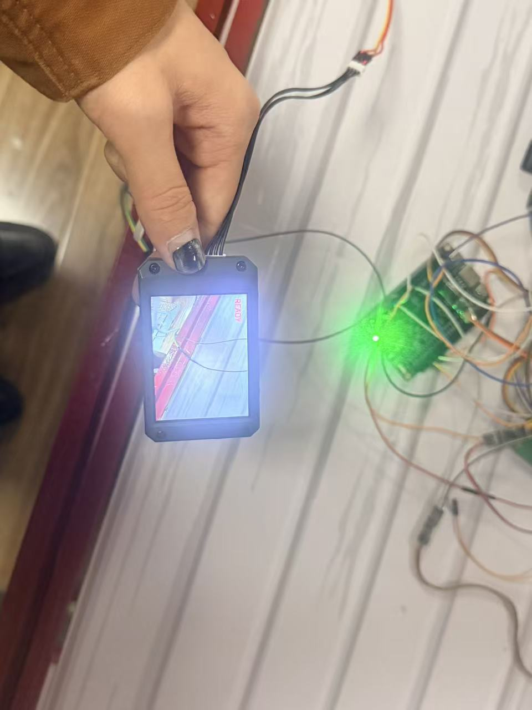

# 多自由度双机协同布袋戏表演系统

**Gesture-Controlled Dual-Puppet Show System** — K230 · PYNQ-Z2 · 2×RA6M5

[](LICENSE)


> **Abstract (EN)** — A dual-puppet show system built from a **K230** vision board, a **PYNQ-Z2** FPGA and two **RA6M5** MCUs.
> The K230 classifies fist/palm gestures with a quantized YOLOv5n-cls model and sends `START` / `STOP` / `READY` over UART;
> the PYNQ-Z2 routes each command to both MCUs through three AXI UART Lite channels and drives four status LEDs;
> each RA6M5 plays six locally stored action groups on 13 PWM channels (50 Hz, 20 ms interpolation).
> No PC is needed while the show is running.

一个用手势控制两台布袋戏人偶协同表演的系统：**K230 识别拳头 / 手掌 → PYNQ-Z2 统一调度 → 两台 RA6M5 各自驱动 13 路舵机、本地播放 6 组动作**。

拳头持续 3 帧启动表演（`START`），手掌持续 3 帧停止（`STOP`），无有效手势 5 帧回到待命（`READY`）。整套动作固化在 MCU 本地，运行时不依赖 PC 逐帧下发。

完整设计说明见 [技术文档 PDF](docs/多自由度双机协同布袋戏表演系统_技术文档.pdf)（16 页，含系统图、接线、参数与实测记录）。



## 目录

- [系统架构](#系统架构)
- [通信协议](#通信协议)
- [硬件与接线](#硬件与接线)
- [关键指标](#关键指标)
- [仓库结构](#仓库结构)
- [快速开始](#快速开始)
- [模型与数据](#模型与数据)
- [验证情况](#验证情况)
- [已知限制](#已知限制)
- [许可证与第三方组件](#许可证与第三方组件)
- [引用](#引用)

## 系统架构



| 层 | 硬件 | 职责 |
|---|---|---|
| 感知层 | CanMV-K230 | 摄像头采集、YOLOv5n-cls 分类、连续帧判决、UART 上报 |
| 调度层 | PYNQ-Z2（Zynq-7020） | PL：3×AXI UART Lite + 4 位 GPIO；PS：Python 解析命令、双路广播、LED 状态 |
| 执行层 | 2×RA6M5（R7FA6M5BF2CBG） | 13 路 50 Hz PWM、动作帧插值、底盘定时停止、停止归位 |

数据流：

```text
摄像头 → K230 推理 → (拳头/手掌/无手势) → START/STOP/READY
      → PYNQ 解析 → 双路 UART 广播 → 两台 RA6M5 → 13 路 PWM → 布袋戏机构
```

三端软件处理流程：



### 三端分工

| 端 | 代码入口 | 关键行为 |
|---|---|---|
| K230 | `k230/deploy_cls.py` + `k230/gesture_logic.py` | 224×224 分类、阈值 0.80、3/5 帧防抖、状态变化即发、稳定后 500 ms 重发 |
| PYNQ | `pynq/runtime/main.py` | 加载 Overlay、解析行协议、`START`/`STOP` 同时写入两路 FIFO 后等待发送、LED0~3 指示 |
| RA6M5 | `mcu/RA6M5_Robot1/src/hal_entry.c` | 命令解析、动作组循环、逐路限幅、20 ms 插值、STOP 先停底盘再归位 |

PYNQ 的 PL 结构（三路 UART 与 LED 的地址分配）：



## 通信协议

三路 UART 均为 **115200 / 8N1 / 3.3 V**，TX/RX 交叉、必须共地。K230 发送 ASCII 行；PYNQ 把 `START`/`STOP` 规范化为 CRLF 后广播给两台 MCU。

| 输入（来自 K230） | PYNQ 行为 | MCU 收到 |
|---|---|---|
| `READY\n` | 记录就绪、点亮 LED1，**不转发** | — |
| `START\n` | 两路同时写入，FIFO 排空后 LED2 亮 | `START\r\n` |
| `STOP\n` | 两路同时写入，FIFO 排空后 LED2 灭 | `STOP\r\n` |

- K230 侧判决：置信度阈值 0.80；连续 3 帧同类确认手势、连续 5 帧低置信度确认无手势；状态变化立即发送，稳定状态每 500 ms 重发一次。
- PYNQ 侧解析：支持拆包与连续多行，单行超过 64 字节整行丢弃；重复 `START`/`STOP` 会再次广播。
- 当前**没有 ACK、没有静默断线超时停机**；`LED2` 只表示命令已提交发送，不代表机构已执行。`READY` 不会停止人偶。

## 硬件与接线

| 信号方向 | PYNQ-Z2 管脚 | 对端 |
|---|---|---|
| K230 → PYNQ | Pmod A1 / Y18（RX） | K230 GPIO9 / UART1 TX |
| PYNQ → K230 | Pmod A2 / Y19（TX） | K230 GPIO10 / UART1 RX（可不接） |
| MCU1 → PYNQ | Pmod B1 / W14（RX） | 第一台 P112 / SCI2 TX |
| PYNQ → MCU1 | Pmod B2 / Y14（TX） | 第一台 P113 / SCI2 RX |
| MCU2 → PYNQ | Pmod B3 / T11（RX） | 第二台 P112 / SCI2 TX |
| PYNQ → MCU2 | Pmod B4 / T10（TX） | 第二台 P113 / SCI2 RX |
| PC 调试 | 不经 PYNQ | 每台 SCI7：TX P613、RX P614 |

> 每块板独立供电时，Pmod 只接信号与 GND，不跨接 3.3 V；舵机使用符合负载的独立电源。



每台 13 路控制通道（头、躯干、双肩、双肘、双腕俯仰/旋转、底盘），两条手臂的机械结构见下图：



## 关键指标

| 项目 | 参数 / 结果 | 说明 |
|---|---|---|
| 视觉识别 | 507/510 = **99.41%** | 裁手版 ONNX 在验证集上的结果；非整机误触发率 |
| 控制通道 | 13 路/台，共 26 路 | 50 Hz PWM，软件目标更新 20 ms |
| 动作规模 | 6 组/台，196 帧，21.68 s | 纯帧时长，不含启停与调度开销 |
| UART | 3 路 × 115200 8N1 | PL 时钟 100 MHz |
| PL 资源 | LUT 840（1.58%）、FF 1057（0.99%）、BRAM 0、DSP 0 | 原实现报告 |
| 时序 | WNS 3.555 ns、WHS 0.069 ns | 原 routed 报告，无失败端点 |
| 软件测试 | PYNQ 23 项单测通过 | PC 模拟，非板端验收 |



## 仓库结构

```text
.
├── k230/                 # 板端脚本 + 模型转换/训练脚本（模型见 Releases）
├── pynq/                 # runtime（含 23 项单测）、systemd、部署说明
├── mcu/                  # RA6M5_Robot1 / RA6M5_Robot2 应用层工程（不含 FSP）
├── fpga/                 # Vivado 源工程：.bd / .xci / .xdc / .xpr
├── docs/                 # 技术文档 PDF、图片、验证记录
├── LICENSE               # AGPL-3.0
└── README.md
```

> 仓库不包含：Renesas FSP 源码、Vivado 生成产物（`.gen`）、Canaan 转换工具、ELF 与哈希清单——原因见[许可证与第三方组件](#许可证与第三方组件)。

## 快速开始

### 1. K230 视觉端

1. 从仓库的 **Releases** 页面下载 `best.kmodel`；
2. 将 `k230/main.py`、`k230/deploy_cls.py`、`k230/gesture_logic.py` 放到板子 `/sdcard/`；
3. 将 `best.kmodel` 放到板子 `/data/fist_palm.kmodel`；
4. CanMV IDE 打开 `deploy_cls.py` 运行（脱机则由 `main.py` 上电自启）。

固件需自带兼容的 `libs.PipeLine` / `libs.YOLO` 与 nncase 2.9 运行时；可先运行 `k230/check_env.py` 自检。



### 2. PYNQ-Z2 调度端

```bash
# 拷贝运行文件到板上
scp -r pynq/runtime/* xilinx@<board-ip>:/home/xilinx/jupyter_notebooks/puppet_show/main_project/

# 运行（与 Notebook 入口二选一）
ssh xilinx@<board-ip>
cd /home/xilinx/jupyter_notebooks/puppet_show/main_project
python3 main.py
```

自启动：`sudo cp pynq/runtime/puppet-show.service /etc/systemd/system/ && sudo systemctl enable --now puppet-show`（路径与 Python 环境需按板上镜像调整）。

单测（PC 上即可运行，不需要板子）：

```bash
cd pynq/runtime && python3 -m unittest discover -v
```

### 3. RA6M5 执行端

需要 **e² studio 2023-04 + FSP 4.5.0 + GNU Arm 10.3.1**。

1. `File → Import → General → Existing Projects`，分别导入 `mcu/RA6M5_Robot1`、`mcu/RA6M5_Robot2`（工程名已区分，可同时导入）；
2. 仓库**不包含 FSP 源码**，导入前请按 `mcu/README.md` 将 FSP 4.5.0 的 `ra/fsp` 放回工程，或让 e² studio 自动生成；
3. Clean 后 Build，按各板探针配置下载。

无 IDE 时也可只编译、不下载：

```bash
python build.py --gcc "<工具链>/bin/arm-none-eabi-gcc.exe"
```

两台工程的 `robot_config.h` 与动作表**不可互换**（初始姿态与限位不同）。

### 4. FPGA 工程

需要 **Vivado 2026.1** 并安装 PYNQ-Z2 板卡文件：

1. 打开 `fpga/puppet_show_pjt/puppet_show_pjt.xpr`，确认器件 `xc7z020clg400-1`、BD 为 `design_1`、顶层 `design_1_wrapper`；
2. 如提示 run 产物缺失，重新生成 BD Output Products → Reset Runs → Synthesis → Implementation → Generate Bitstream；
3. **只想运行可直接用 Releases 里的 `triple_uart.bit` + `triple_uart.hwh`**（两者必须成对使用）。

## 模型与数据

- 模型：YOLOv5n-cls，224×224 输入，两分类（`fist` / `palm`）；
- 训练：HaGRID 采样中的 fist/palm，按标注框裁手（随机扩边 1.3~2.6 倍）并保留 20% 整幅图，共 3604 张；80 epochs；
- 导出：legacy exporter → opset 12 / IR 7 的 ONNX；
- 量化：nncase 2.9.0，uint8 PTQ，校准图取自裁手验证集；产物 `best.kmodel` 约 1.3 MB；
- 训练与转换脚本见 `k230/scripts/`，数据集不随仓库分发。

模型与权重以 **GitHub Releases** 附件形式提供（含 `.kmodel`、`.onnx`、`.pt`），不占用仓库体积，也无需 Git LFS。

## 验证情况

| 项 | 结果 | 范围 |
|---|---|---|
| PYNQ 单测 | 23 项通过 | PC 模拟（mock `pynq`），覆盖拆包、非法/超长行、1000 条顺序、单路失败、LED |
| K230 判决 | 现有断言通过 | PC 执行 `test_gesture_logic.py`，不重新训练/评估 |
| MCU 构建 | 两台编译链接通过 | GNU Arm 10.3.1，未下载到板卡 |
| Vivado | 沿用原实现报告 | 未重新综合，位流与 hwh 已做哈希核对 |

**本次未做的实机验收**：K230→PYNQ→双 MCU 端到端启停、冷启动、双机同步偏差、PWM 波形、STOP 响应时间、机械干涉与负载、长时间运行。仓库不报告这些未测量指标。

## 已知限制

1. **无执行确认**：协议没有 ACK，`LED2` 仅表示命令已提交，MCU 是否执行不可知；
2. **无断线保护**：没有心跳超时，K230 掉线时人偶会保持当前动作；
3. **双机非严格同步**：两路 UART 由 Python 先后写寄存器，启动存在不确定偏差；
4. **空画面可能误报**：两分类模型缺少明确的“无手势”类，阈值只能降低概率；
5. **机械参数未标定**：软件限幅是配置值，不等于实测关节角度或碰撞边界；
6. **第二台动作组待实机验收**：差异动作已编排，但完整动作与干涉尚未上机确认。

## 许可证与第三方组件

本仓库代码以 **GNU Affero General Public License v3.0（AGPL-3.0）** 发布，详见 [LICENSE](LICENSE)。

| 组件 | 许可 | 仓库内状态 |
|---|---|---|
| YOLOv5 / `yolov5n-cls.pt` | AGPL-3.0 | 权重与转换结果放在 Releases |
| HaGRID 数据集 | CC BY-SA 4.0（变体） | 仅训练使用，未分发数据集 |
| PYNQ | BSD-3-Clause | 板上运行框架，未随仓库分发 |
| ARM CMSIS | Apache-2.0 | 随 MCU 工程保留原许可 |
| Renesas FSP 4.5.0 | Renesas 自有许可 | **不随仓库分发**，需按官方渠道安装 |
| Xilinx Vivado / IP | Xilinx 许可 | 仅提供 `.bd/.xci/.xdc/.xpr` 源，未含生成产物 |
| Canaan `test_yolov5` | 未标注 | **不随仓库分发**，按官方渠道获取 |

使用 HaGRID 训练的模型时，请同时遵守数据集许可并保留署名（见下方引用）。

## 引用

如果本项目的思路或代码对你有帮助，可以引用所用的数据集论文：

```bibtex
@InProceedings{Kapitanov_2024_WACV,
  author    = {Kapitanov, Alexander and Kvanchiani, Karina and Nagaev, Alexander and Kraynov, Roman and Makhliarchuk, Andrei},
  title     = {HaGRID -- HAnd Gesture Recognition Image Dataset},
  booktitle = {Proceedings of the IEEE/CVF Winter Conference on Applications of Computer Vision (WACV)},
  month     = {January},
  year      = {2024},
  pages     = {4572-4581}
}
```

---

本项目为竞赛作品的开源整理版本：文档与照片已做匿名化处理，不包含参赛者身份信息。
